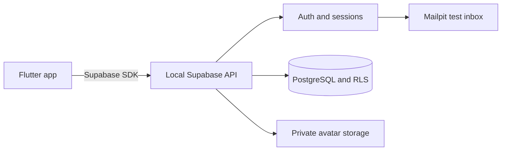

# Chripy

A small social app built with **Flutter** and **Supabase**. Share short text posts, join conversations, and manage your profile while learning how a mobile app talks to PostgreSQL.

Chripy's current development setup runs Supabase on your Windows PC through Docker. Preview the app in Chrome, then build an iPhone version using the included Codemagic workflow.

[Getting started](#getting-started) · [Configuration](#configuration) · [Project structure](#project-structure) · [Testing](#testing) · [iPhone builds](#iphone-builds) · [Troubleshooting](#troubleshooting)

## Features

- Email/password signup, email-code confirmation, login, and logout.
- Password recovery using a code from the local email inbox.
- Profile onboarding with a unique username, display name, and bio.
- A chronological feed with refresh and pagination.
- Text posts of up to 280 Unicode code points; edit or delete your own posts.
- Replies, reply deletion, and like/unlike actions.
- Author profiles and their post history.
- Private profile photos with resizing, replacement, and removal.
- Database ownership rules enforced through Row Level Security (RLS).

This version is intended for local learning with test accounts. Following, direct messages, image posts, notifications, realtime updates, and offline synchronization are outside its current scope. Your PC and local backend must be running for the app to load and save content.

## How it works



Flutter uses Supabase's HTTP APIs rather than connecting directly to PostgreSQL. Auth manages passwords and sessions. Database grants and RLS decide which records each signed-in user can change.

| Component | Purpose |
| --- | --- |
| Flutter / Dart | App screens, navigation, validation, and client logic |
| Supabase Auth | Accounts, email verification, recovery, and sessions |
| PostgreSQL | Profiles, posts, replies, likes, and ownership rules |
| Supabase Storage | Private avatar files |
| Mailpit | Local signup and recovery emails |
| Node.js / Supabase CLI | Project bootstrap and local backend commands |
| Codemagic | macOS-based iPhone compilation |

## Getting started

Commands below use PowerShell from the repository root unless a step says otherwise. For the longer walkthrough, see the [step-by-step tutorial](TUTORIAL.md).

### Prerequisites

Install [Flutter](https://docs.flutter.dev/install), [Node.js](https://nodejs.org/), [Git](https://git-scm.com/), [Docker Desktop](https://docs.docker.com/desktop/setup/install/windows-install/), and Chrome. Use Docker's Linux container engine. VS Code with the Dart and Flutter extensions is useful for editing and debugging.

The last recorded successful checks used **Flutter 3.47.7 / Dart 3.13.5**. The committed lockfile currently requires Flutter **3.47.0+** and Dart **3.13.0+**. Keep `mobile/pubspec.lock` when resolving packages.

Check the tools before continuing:

```powershell
flutter --version
flutter doctor -v
node --version
docker version
```

Docker should report both a client and a running server. Android and Windows-desktop toolchains are only needed if you choose those targets.

### 1. Get the project

```powershell
git clone https://github.com/JustinJ03/chripy_supabase.git
Set-Location chripy_supabase
npm ci
```

If you already have a working copy, open its root folder and install only the dependencies you need. `npm ci` installs the versions recorded in `package-lock.json`.

### 2. Complete first-time setup

For a fresh checkout, run:

```powershell
npm run setup
```

Setup generates missing iOS/web scaffolding, configures local email-code authentication and templates, adds iOS development permissions, and creates `mobile/config.local.json` if absent. It preserves the supplied app source while generating platform files.

**Run setup for initial preparation.** A rerun reapplies its managed Auth and iOS settings. An already configured working copy normally needs only the daily commands below.

### 3. Start Supabase

Start Docker Desktop, then run:

```powershell
npm run backend:start
npx supabase migration up --local
npm run backend:status
```

The first start downloads container images and can take several minutes. Use the URLs and client key printed by your CLI. Local startup may apply migrations automatically; `migration up --local` applies any remaining pending migrations. See the [official local-development guide](https://supabase.com/docs/guides/local-development/cli/getting-started) for CLI setup details.

### 4. Configure the app

Edit `mobile/config.local.json` using your local **publishable** key, or the legacy **anon** key if that is what your stack provides:

```json
{
  "SUPABASE_URL": "CHECK_LOCAL_SUPABASE_ADDRESS",
  "SUPABASE_PUBLISHABLE_KEY": "YOUR_LOCAL_PUBLISHABLE_OR_ANON_KEY"
}
```

The file is ignored by Git. Never use a secret/service-role key or database password in the Flutter app. Keep privileged credentials out of screenshots and commits.

### 5. Run Chripy

```powershell
Set-Location mobile
flutter pub get
flutter analyze
flutter test
flutter run -d chrome --web-port=5173 --dart-define-from-file=config.local.json
```

Open **http://localhost:5173**. Select **Register**, create a test account with a password of at least 10 characters, then open Mailpit on your PC. Enter the six-digit code in Chripy and create your profile.

Try posting, replying, liking, and editing your profile. Register a second test user to check interactions and ownership. The [tutorial](TUTORIAL.md) includes a fuller acceptance checklist.

## Configuration

| Setting | Used by | Notes |
| --- | --- | --- |
| `SUPABASE_URL` | Flutter and Codemagic | Loopback for the PC browser; PC home-network IP for an iPhone |
| `SUPABASE_PUBLISHABLE_KEY` | Flutter and Codemagic | Client publishable key or local legacy anon key |
| `supabase/config.toml` | Local Supabase | Service ports, Auth behavior, and email templates |
| `mobile/ios/Runner/Info.plist` | iOS app | Photo/local-network usage descriptions and development HTTP settings |

Flutter reads the two app settings at build time through `--dart-define-from-file`. After changing them, stop and rerun the browser app or rebuild the IPA. Hot reload does not update compiled configuration.

Browser preview intentionally drops its saved login after a full page reload. Native sessions use the `SessionStore` adapter backed by secure storage.

## Everyday development

From the root, start Docker and Supabase:

```powershell
npm run backend:start
Set-Location mobile
flutter run -d chrome --web-port=5173 --dart-define-from-file=config.local.json
```

Press `r` in Flutter's terminal for hot reload and `q` to stop the app. When finished, stop the backend from the root:

```powershell
Set-Location ..
npm run backend:stop
```

A normal stop/start preserves local data. **`supabase db reset` and deleting Docker volumes destroy local data**; they are not everyday restart commands. Keep backups of anything valuable.

## Project structure

```text
chripy_supabase/
├── mobile/
│   ├── lib/
│   │   ├── main.dart             # Screens, navigation, dialogs, and UI state
│   │   ├── repository.dart       # Supabase queries and avatar processing
│   │   ├── session_store.dart    # Secure native session persistence
│   │   └── validation.dart       # Shared input and Unicode-length rules
│   ├── test/                     # Validation and widget regression tests
│   ├── ios/                      # Generated iOS project
│   ├── web/                      # Generated browser project
│   ├── config.example.json       # Safe configuration template
│   └── pubspec.yaml              # Flutter dependencies and app version
├── scripts/                      # Bootstrap and iOS configuration helpers
├── supabase/
│   ├── migrations/               # Schema, permissions, views, and avatar policies
│   ├── templates/                # Confirmation and recovery email templates
│   └── tests/ownership.sql        # Transactional database ownership checks
├── docs/
│   └── VALIDATION.md             # Completed checks and remaining device checks
├── TUTORIAL.md                   # Detailed Windows-to-iPhone walkthrough
└── codemagic.yaml                # Analyze, test, compile, and package iOS
```

The handwritten code includes detailed comments for learning. Start with `main()` in `main.dart`, then follow `AuthGate`, `ProfileGate`, `Timeline`, and `Repository`. `db.DataRow` names a database record; Flutter's `Row(...)` lays out widgets horizontally. Keep those names distinct when editing.

## Testing

Run Flutter checks from `mobile/`:

```powershell
dart format --output=none --set-exit-if-changed lib test
flutter analyze
flutter test
```

The current 11 tests cover validation boundaries, the setup screen, composer behavior, profile Unicode limits, ended sessions, and post-card disposal while dialogs are open. They do not require a running Supabase server.

Check the Node helpers from the repository root:

```powershell
node --check scripts/setup.mjs
node --check scripts/configure-ios.mjs
```

For database checks, run [ownership.sql](supabase/tests/ownership.sql) in the **local** Studio SQL editor. Its fixtures run inside a transaction and roll back. It checks cross-user mutations, duplicate likes, protected ownership columns, counts, cascades, and anonymous access.

Read [VALIDATION.md](docs/VALIDATION.md) for the recorded results and limitations. Full email/recovery/photo workflows and physical iPhone behavior still need manual verification.

## iPhone builds

The included [Codemagic workflow](codemagic.yaml) builds an unsigned physical-device release on macOS and packages `chripy-unsigned.ipa`.

1. Push the project, generated `mobile/ios` files, and lockfiles to your repository.
2. Connect the repository to [Codemagic](https://docs.codemagic.io/yaml-quick-start/building-a-flutter-app/).
3. Create the environment group `chripy` containing `SUPABASE_URL` and `SUPABASE_PUBLISHABLE_KEY`.
4. For a phone connected to home Wi-Fi, use `http://YOUR_PC_HOME_WIFI_IP:54321` as the URL. Keep the PC and phone on the same trusted network.
5. Run `chripy-ios`, download its IPA, and use [Sideloadly](https://sideloadly.io/) on Windows to sign/install it. Follow its current Apple-driver and account requirements locally.

`localhost` on the iPhone points to the phone itself. Confirm API reachability, local-network permission, and a narrowly scoped private-network firewall rule before testing the app. The cloud builder embeds the URL and does not need to reach your PC to compile.

See the [tutorial's networking and installation steps](TUTORIAL.md#11-make-local-supabase-reachable-from-the-iphone) for the detailed route. The development plist permits HTTP for the local backend; remove that exception when moving to hosted HTTPS distribution.

## Troubleshooting

| Problem | What to check |
| --- | --- |
| Flutter or npm is missing | Check PATH and reopen the terminal after installation |
| PowerShell blocks `npm.ps1` | Use `npm.cmd` / `npx.cmd` for the same commands |
| Docker cannot connect | Start Docker Desktop and wait for the Linux engine |
| Chripy shows a setup error | Check `config.local.json`, pass `--dart-define-from-file`, then restart the app |
| Tables are missing | Run `npx supabase migration up --local` from the root |
| Verification email is missing | Check the local Mailpit instance, Auth confirmations, and resend cooldown |
| Browser works but phone fails | Check the compiled LAN URL, same Wi-Fi, network isolation, firewall, and iOS permission |
| An avatar cannot be decoded | Select JPEG/PNG; export HEIC as JPEG if needed |
| VS Code shows errors after external edits | Save/compare the file, then run **Dart: Restart Analysis Server** |
| `Row` / `DataRow` errors appear | Keep the `db` import prefix; do not replace the Flutter widget or Dart keywords |
| CI rejects the lockfile | Run `flutter pub get` locally and commit the resulting consistent lockfile |
| Installed app stops launching later | Check signing validity and renew it through the installation tool |

## Contributing

Keep changes focused, run analysis/tests, and describe what you changed and how you verified it. Add a new migration for schema changes that have already been applied locally. Commit source and lockfiles; keep local configuration, signing material, build output, and `node_modules` out of Git.

The [changelog](CHANGELOG.md) tracks project changes. No license file is currently included; agree on licensing before redistributing the code.
